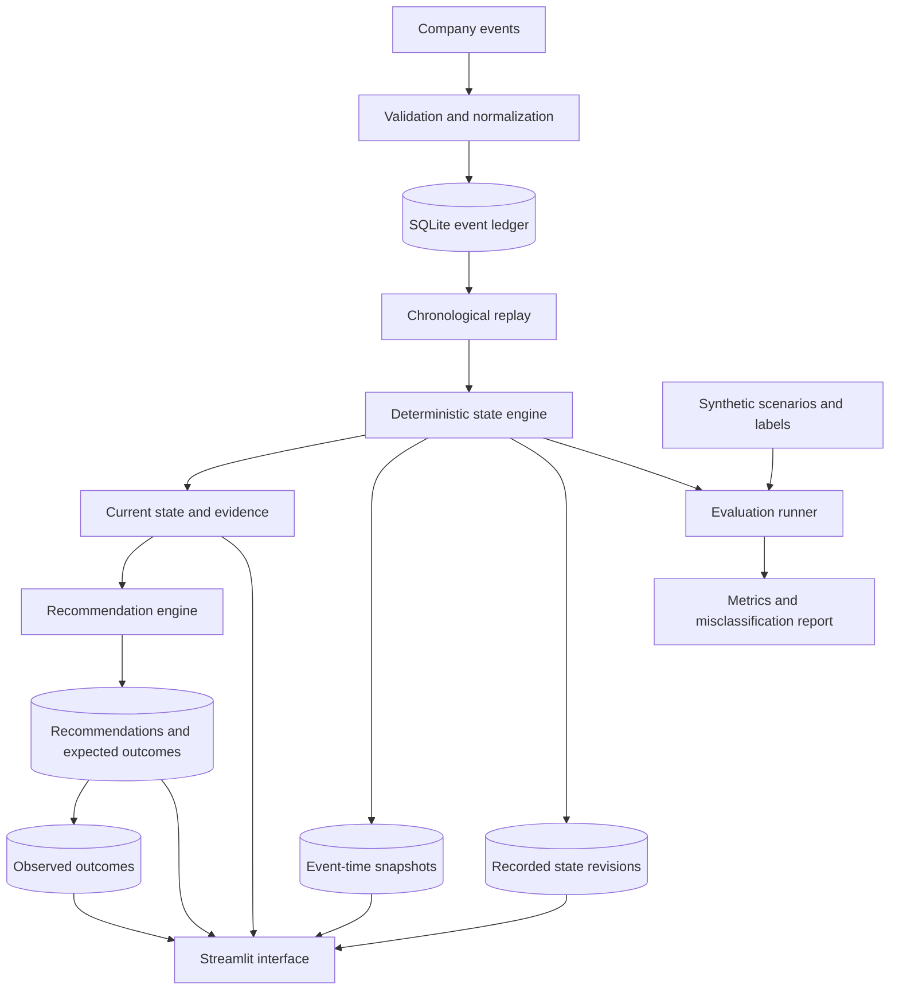

# Living State Engine

An evidence-backed project state engine that reconstructs a project's current status from company events, explains its estimates, recommends next actions, and records expected versus actual outcomes.

Inspired by Chetto's concept of a living organizational model. This is an independent implementation, not a clone of an existing Chetto project.

## Problem

Project updates are often incomplete, delayed, or contradictory. A single status field cannot reliably represent outstanding commitments, unresolved issues, delivery risks, and blockers.

The Living State Engine maintains a deterministic estimate of project state from an event ledger. Every important estimate can be traced to its supporting event IDs, and historical estimates can be inspected.

## Features

- **Event ingestion:** Validates and stores project events in SQLite.
- **Idempotency:** Ignores exact duplicate events and rejects conflicting reuse of event IDs.
- **Out-of-order handling:** Reconstructs project state in event-time order.
- **State estimation:** Tracks `unknown`, `healthy`, `at_risk`, `blocked`, and `completed`.
- **Evidence provenance:** Links state estimates and recommendations to event IDs.
- **Commitment tracking:** Records owners, deadlines, completion, and overdue commitments.
- **Risk and issue tracking:** Maintains open and resolved items with severity.
- **Historical state:** Persists event-time snapshots and recorded current-state revisions.
- **Recommendations:** Selects a deterministic next action and defines an expected outcome.
- **Outcome tracking:** Records observed outcomes and evaluates them against the recommendation's success criterion.
- **Local interface:** Uses Streamlit to replay events, inspect evidence, browse history, and evaluate recommendations.
- **Reproducible evaluation:** Includes synthetic datasets, hand-authored labels, simple baselines, and failure-case benchmarks.

## Architecture



## Tech stack

- Python 3.11+
- SQLite, through Python's standard library
- Streamlit
- pytest

No paid APIs, external model services, or API keys are required.

## Setup

Open PowerShell in the project root.

Create a virtual environment:

```powershell
python -m venv .venv
```

Install the dependencies:

```powershell
.\.venv\Scripts\python.exe -m pip install -r requirements.txt
.\.venv\Scripts\python.exe -m pip install -e .
```

## Run the application

Generate the original synthetic dataset:

```powershell
.\.venv\Scripts\python.exe scripts\generate_dataset.py
```

Start Streamlit:

```powershell
.\.venv\Scripts\python.exe -m streamlit run .\app.py
```

Open the local URL printed by Streamlit, normally `http://localhost:8501`.

Click **Load synthetic dataset** in the sidebar to populate the local SQLite database.

## Demo: healthy to at-risk and back

Select the project `high_risk_contradiction-01`.

Move the **Events replayed** slider through the following states:

| Events replayed | Expected status | Supporting evidence |
|---:|---|---|
| 1 | `healthy` | Initial healthy status update |
| 2 | `at_risk` | A high-severity risk is raised |
| 3 | `at_risk` | A contradictory healthy report does not resolve the risk |
| 4 | `healthy` | The risk is explicitly resolved |

Inspect the Current state & evidence and History tabs to trace the estimate to the source events.

The replay slider is an inspection tool. It reconstructs the state using the first N events in event-time order; it does not simulate live event arrival.

Loading the synthetic dataset in one batch records the resulting state revision. It does not pretend the historical events were observed live, one by one.

## Tests

Run the complete test suite:

```powershell
.\.venv\Scripts\python.exe -m pytest -q
```

The latest recorded test run before the final UI wiring reported 32 passing tests. Rerun the suite against the current checkout to verify the final application integration.

## Evaluation

### Original benchmark

Generate the dataset and run evaluation:

```powershell
.\.venv\Scripts\python.exe scripts\generate_dataset.py
.\.venv\Scripts\python.exe scripts\evaluate_dataset.py
```

The recorded run contains 64 synthetic projects, 256 events, and 256 hand-labeled state estimates across eight repeated scenario templates.

| Metric | State engine | Latest-status baseline |
|---|---:|---:|
| Exact state accuracy | 100% (256/256) | 75% (192/256) |
| Risk precision | 100% | 0% |
| Risk recall | 100% | 0% |
| Risk F1 | 1.00 | 0.00 |

### Challenge benchmark

Run the expanded challenge benchmark:

```powershell
.\.venv\Scripts\python.exe scripts\run_challenge_benchmark.py
```

Results are saved under `data/synthetic/`.

The latest recorded run contains 12 hand-authored scenarios, 48 events, and 48 labeled state estimates.

| Metric | State engine | Latest-status baseline |
|---|---:|---:|
| Exact state accuracy | 100% (48/48) | 68.75% (33/48) |
| Risk precision | 100% | 100% |
| Risk recall | 100% | 6.25% |
| Risk F1 | 1.00 | 0.1176 |

The state engine recorded 16 true positives, 32 true negatives, zero false positives, and zero false negatives for risk detection, where `at_risk` and `blocked` count as positive states.

These figures are recorded results from synthetic benchmark runs, not independently verified real-world accuracy.

## Evaluation limitations

- The scenario labels are hand-authored and may align with the rules being evaluated.
- The original dataset repeats eight templates. These repetitions are not independent real-world projects.
- The challenge benchmark contains only 12 distinct synthetic scenarios.
- The latest-status baseline is intentionally simple and is not representative of every alternative approach.
- A successful outcome match does not establish that a recommendation caused the result.
- No real organizational data has been evaluated.
- Production throughput, latency, and scalability have not been established.

The benchmarks are designed to expose implementation errors, document failure cases, and make evaluation reproducible. Further evaluation requires additional independently designed scenarios and, eventually, independently labeled organizational data.

## Storage and data integrity

The application stores its local database at:

`data/living_state_engine.db`

The database file is ignored by Git because it contains local mutable state.

The event ledger preserves event identity and event time. State snapshots are refreshed when reconstructed history is persisted, while recorded state revisions retain previous estimates when the current recorded estimate changes.

Recommendations and their recorded outcomes are stored separately.

The synthetic event streams, labels, and evaluation reports are retained as benchmark artifacts. The dataset is explicitly labeled synthetic.

## Current limitations

- The state engine uses deterministic rules rather than a learned model.
- Status estimates depend on the completeness and reliability of the event stream.
- The application does not yet prove that a recommendation caused a positive outcome.
- Synthetic evaluation does not establish generalization to real organizations.
- Historical revisions are recorded when the application persists reconstructed state, not for every slider movement.

## Project status

Implemented: event ingestion, duplicate protection, chronological replay, deterministic state estimation, evidence references, recommendations, outcome recording, SQLite state persistence, Streamlit UI, tests, and synthetic evaluation scripts.

Still requiring verification: the final end-to-end workflow after UI changes, clean-checkout reproducibility, broader adversarial evaluation, and release-ready repository hygiene.

## Inspiration

- Chetto: https://chetto.ai/blog/every-organization-will-need-a-living-model-of-itself
- Chetto thesis: https://chetto.ai/thesis
